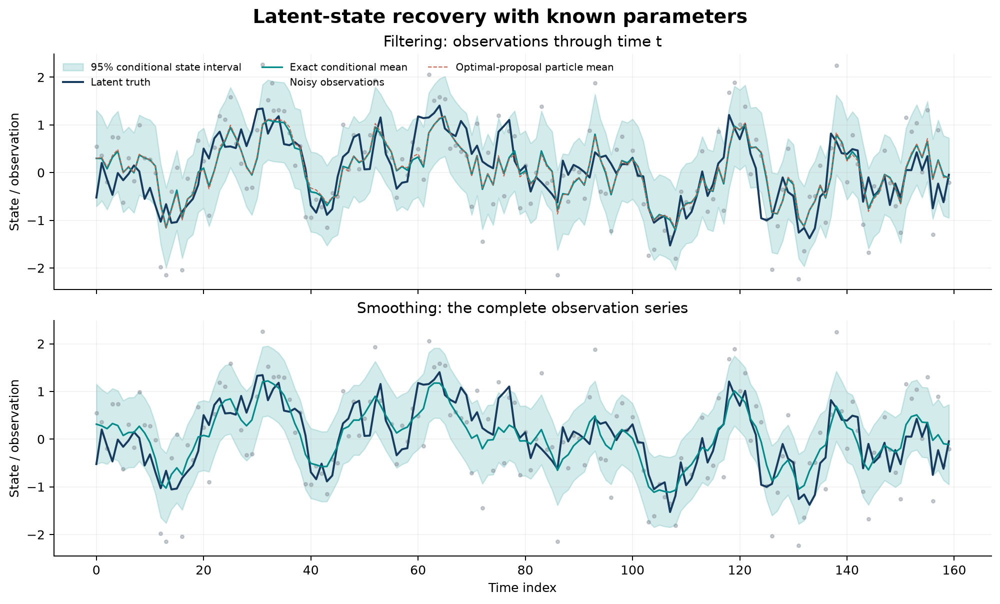
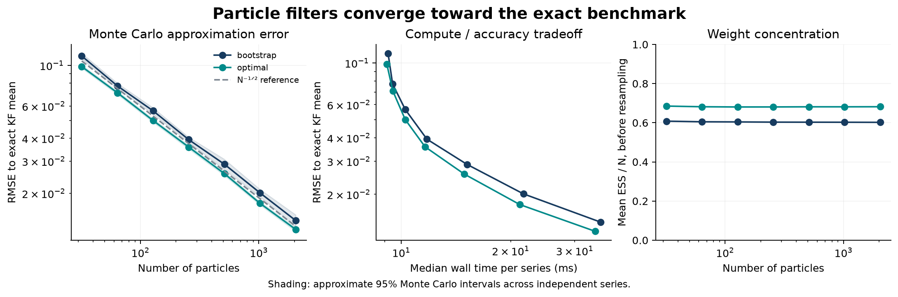

# How Reliably Can We Recover Hidden States from Noisy Data?

**Identifiable state-space inference, exact benchmarks, and auditable Monte Carlo research.**

An original Python implementation of Kalman likelihood estimation, RTS smoothing,
and sequential Monte Carlo. The central contribution is the experimental design:
fix the latent scale, keep information sets comparable, separate parameter error
from particle error, and report uncertainty and unsuccessful fits transparently.

[Read the complete experiment report](results/full/REPORT.md) ·
[Run the tutorial](notebooks/tutorial.ipynb) ·
[Inspect the derivations](docs/METHODS.md) ·
[Review the limitations](docs/LIMITATIONS.md)



## Research findings

The committed experiment ran **1,000 independent trials of 160 observations** at
$\phi=0.85,q=0.16,r=0.49,\alpha=1$. Every trial and optimizer outcome is saved.
These are synthetic inference experiments, with no trading-performance claim.

| State estimator | Mean squared error | 95% state-interval coverage |
| --- | ---: | ---: |
| Exact Kalman filter, known parameters | 0.1839 | 95.06% |
| Bootstrap PF, 256 particles, known parameters | 0.1853 | 94.42% |
| Optimal-proposal PF, 256 particles, known parameters | 0.1851 | 94.41% |
| Kalman filter, full-sample estimated parameters | 0.1943 | 92.81% |
| RTS smoother, known parameters, future observations available | 0.1408 | 94.98% |

- **Identification comes first.** A free observation loading and a free state-noise
  variance cannot both be identified from this model's observations. A 101-point
  rescaling experiment demonstrates the exact likelihood ridge and its effect on
  misleading state RMSE comparisons.
- **Particles converge to the exact Gaussian solution.** Across 60 independent
  series and seven particle counts, approximation error declines as particle count
  rises. The study reports paired risk differences, ESS, likelihood error, and
  runtime; it does not suggest particles improve an exact conditional mean.
- **Fitting parameters affects calibration.** Plug-in state coverage falls to
  92.81% in this experiment. All 1,000 selected MLE fits converged; six reached a
  computational boundary, leaving 994 usable observed-information interval sets.
  Boundary trials remain in every point-estimate and state-risk summary.
- **Model flexibility matters under misspecification.** Under 5% contaminated
  observations, a PF supplied the true mixture model has MSE 0.2034 versus 0.5022
  for a misspecified Gaussian KF. This is a model-specification comparison.
- **Nonlinear validation adds a second setting.** A stochastic-volatility PF is
  checked against a deterministic grid filter, including a two-resolution audit.
  The study also evaluates a log-squared-observation Gaussian approximation.

The [generated report](results/full/REPORT.md) includes Monte Carlo intervals,
parameter bias/RMSE/coverage, multiplicity-adjusted bias tests, chronological
holdout scores, stress results, bootstrap refits, and the exact execution manifest.

## Install and reproduce

Python 3.10 or newer:

```bash
python -m venv .venv
source .venv/bin/activate
python -m pip install -e '.[dev]'

# Quick end-to-end validation; a fresh output directory is required.
latent-state-lab run --profile quick --output results/quick

# Full predeclared suite: 1,000 core trials and all secondary studies.
OPENBLAS_NUM_THREADS=1 OMP_NUM_THREADS=1 \
  latent-state-lab run --profile full --workers 2 --output results/reproduced

pytest -q
ruff check src tests scripts
python scripts/verify_results.py results/reproduced
```

`python -m latent_state_lab.cli` is equivalent to the installed command. With no
editable installation, prefix it with `PYTHONPATH=src`. The completed full run took
about 1–2 minutes on the recorded machine; this is an environment-specific measurement.
The package refuses to overwrite a nonempty experiment directory. `--seed` and
`--workers` are explicit, and changing worker count preserves random streams.

For the exact numerical package versions used in the committed results, see
[requirements-reproduction.txt](requirements-reproduction.txt) and
[the manifest](results/full/manifest.json). Version ranges in `pyproject.toml` support
normal installation; bit-for-bit agreement across different platforms is not promised.

```bash
# Regenerate charts/report from existing raw results, without rerunning simulations.
latent-state-lab render results/full

# Execute all plain-Python tutorial cells and refresh notebook outputs.
python scripts/execute_notebook.py
```

## Model and inference

$$
x_0\sim N\!\left(0,\frac{q}{1-\phi^2}\right),\quad
x_t=\phi x_{t-1}+\eta_t,\quad
y_t=\alpha x_t+\epsilon_t,
$$

with independent $\eta_t\sim N(0,q)$, $\epsilon_t\sim N(0,r)$, and **known**
$\alpha=1$ in the main study. `q` and `r` always mean variances.

```python
import numpy as np
from latent_state_lab import Parameters, simulate, fit_mle, kalman_filter, rts_smoother

data = simulate(160, Parameters(), np.random.default_rng(42))
fit = fit_mle(data.y)                 # exact marginal likelihood; alpha fixed
filtered = kalman_filter(data.y, fit.parameters)
smoothed = rts_smoother(filtered, fit.parameters)
print(fit.parameters, fit.success, fit.ci_valid)
```

This example's parameters use the complete sample, so both outputs are retrospective.
The separate holdout experiment fits a training prefix and freezes parameters before
sequentially processing test observations.

## Included experiments

| Experiment | Full-profile scope | Question |
| --- | --- | --- |
| Core Monte Carlo | 1,000 trials, T=160, two PF proposals | State risk, parameter recovery, interval calibration |
| Particle-count convergence | 60 series × 7 counts × 2 proposals | Numerical error and compute tradeoff |
| Missingness and outliers | 100 trials per scenario, 4 scenarios | Missing information versus model misspecification |
| Chronological holdout | 100 trials, 240 train / 160 test | Parameter look-ahead and predictive scoring |
| Stochastic volatility | 60 trials, grid + PF + Gaussian approximation | Non-Gaussian observation inference |
| Parameter refit bootstrap | 200 independent refits of one fitted model | Illustrative parameter uncertainty |
| Scale equivalence | 101 fixed rescalings | Identification and state-unit consistency |



## Validation and repository map

The test suite independently checks innovation likelihoods against dense Gaussian
densities, filter/smoother moments against direct conditioning, analytic scores
against finite differences, scale equivalence, missing-data behavior, resampling
offspring frequencies, likelihood-estimator normalization, PF convergence, and SV
grid refinement. CI runs tests and an end-to-end smoke experiment on Python 3.10/3.12.

```text
src/latent_state_lab/
  model.py                  stationary model and identifiable units
  kalman.py                 exact filter, likelihood score, and RTS smoother
  estimation.py             multistart MLE, observed information, oracle fit
  particle.py               log-space bootstrap and optimal-proposal SMC
  stochastic_volatility.py  nonlinear PF and grid reference
  experiments.py            fixed protocols, seed streams, raw outputs, manifest
  metrics.py                trial-level inference and interval accounting
  plotting.py / reporting.py generated figures and numerical report
tests/                      numerical and statistical validation
notebooks/tutorial.ipynb    executed end-to-end tutorial
docs/                       derivations, provenance, limitations, interview guide
results/full/               committed raw trial results, report, and 7 PNG/PDF figures
scripts/                    notebook execution and result-integrity checks
```

## Scientific scope and provenance

The filtering algorithms are established methods. This repository contributes an
independent implementation, an explicit scale-identification diagnosis, and a
reproducible evaluation design.
See [references](docs/REFERENCES.md) for methodological sources and attribution.

Conditional state intervals do not integrate parameter uncertainty. Oracle parameter
fits and smoothers use privileged information. Contamination and stochastic-volatility
parameters are known in their stress experiments. These choices are explicit in
the [limitations](docs/LIMITATIONS.md) and [interview guide](docs/INTERVIEW_GUIDE.md).

MIT licensed.
