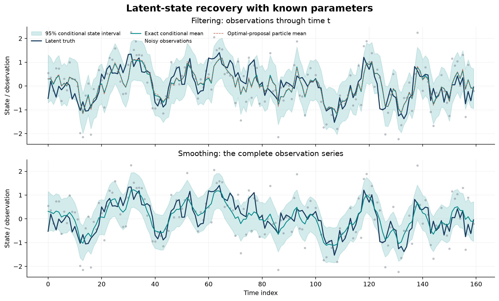
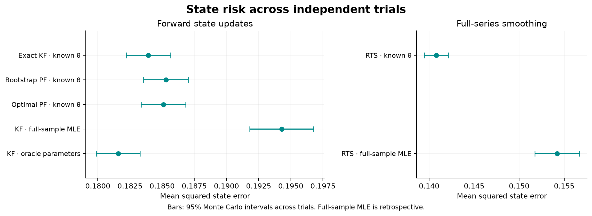
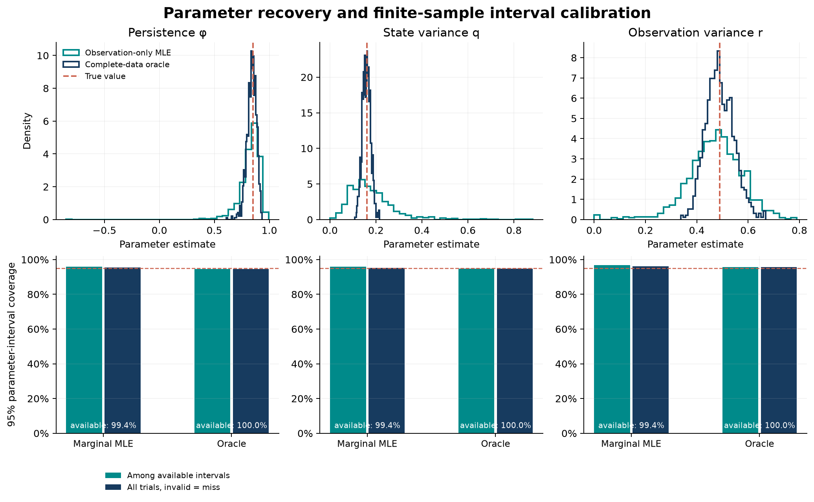
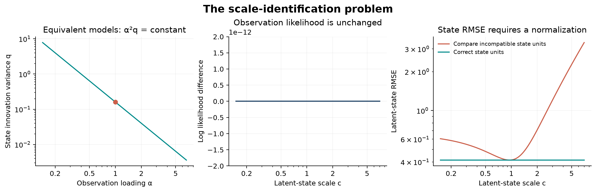
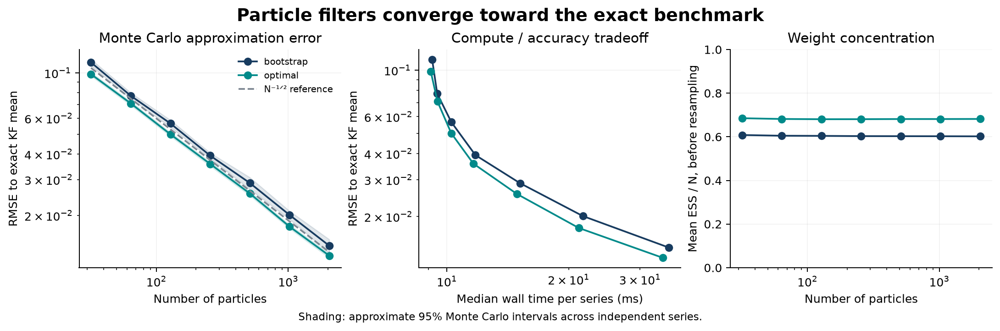
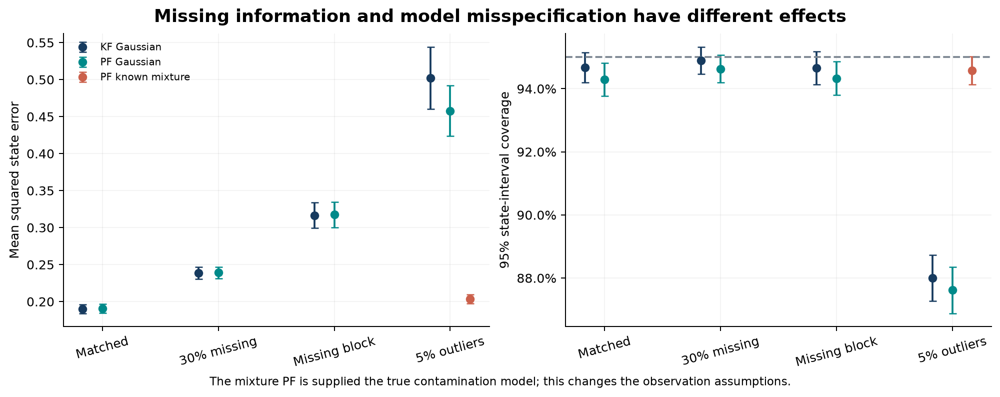
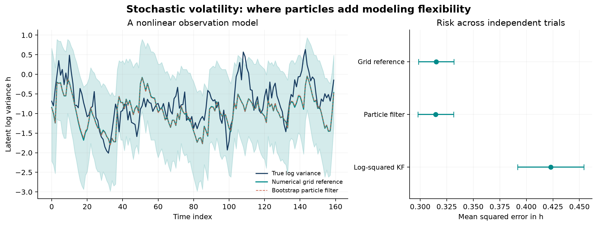

# How Reliably Can We Recover Hidden States from Noisy Data?

## Reproducible experiment report

This report is generated from the CSV and JSON files in this directory. It describes
the **full** profile: **1,000 independent core trials**, each
of length **160**, with **256 particles** per core PF.
The master seed is `20261117`. Every data and particle stream is independently
derived from an explicit trial identifier. All trials remain in the analysis.

## What this experiment establishes

The observation loading is fixed at α=1, so latent-state scale is identified. Under
the correctly specified linear Gaussian model, the exact Kalman conditional mean
is the minimum expected squared-error estimator using the same observations and
known parameters. A particle filter approximates this solution; it cannot improve
its population risk merely by adding simulation. Smoothing and oracle parameter
estimation use different information and are identified separately below.

The measured known-parameter filtering MSE is **0.1839**, versus
**0.1408** for smoothing with future observations. These are synthetic
inference results, not trading returns or evidence of market predictability.



## State recovery and conditional interval coverage

| Method | Mean MSE | Mean trial RMSE | 95% state coverage | Mean interval width |
| --- | --- | --- | --- | --- |
| KF_full_sample_MLE | 0.1943 | 0.4388 | 0.9281 | 1.6193 |
| KF_known | 0.1839 | 0.4277 | 0.9506 | 1.6802 |
| KF_oracle_parameters | 0.1816 | 0.4249 | 0.9500 | 1.6648 |
| PF_bootstrap_known | 0.1853 | 0.4292 | 0.9442 | 1.6659 |
| PF_optimal_known | 0.1851 | 0.4290 | 0.9441 | 1.6720 |
| RTS_full_sample_MLE | 0.1542 | 0.3902 | 0.9238 | 1.4279 |
| RTS_known | 0.1408 | 0.3742 | 0.9498 | 1.4698 |

MSE is averaged over time within a trial and then across independent trials. Mean
trial RMSE is a different estimand from the square root of pooled MSE. State coverage
is the fraction of latent states inside pointwise intervals, averaged across trials;
these are not simultaneous confidence bands. Gaussian methods use exact conditional
Gaussian intervals for the supplied parameters. PF intervals are weighted empirical
quantiles. For full-sample MLE, those intervals **ignore parameter-estimation
uncertainty** and their empirical coverage is the diagnostic of that omission.

`KF_full_sample_MLE` performs forward state updates after estimating parameters on
the entire series. It is retrospective empirical Bayes, not a real-time trading
filter. `KF_oracle_parameters` estimates parameters using the latent states, then
filters using observations only. It is a privileged benchmark, not an achievable
strategy or a guaranteed lower bound. RTS explicitly uses future observations.
An oracle parameter fit can even beat the known-parameter KF on this experiment:
its fitted parameters carry information from the latent path, so the two estimators
do not have the same information set.



### Paired risk differences

| Comparison | Mean MSE difference | MCSE | 95% MC lower | 95% MC upper |
| --- | --- | --- | --- | --- |
| KF_full_sample_MLE minus KF_known | 0.0104 | 0.0010 | 0.0084 | 0.0123 |
| KF_oracle_parameters minus KF_known | -0.0023 | 0.0001 | -0.0026 | -0.0021 |
| PF_bootstrap_known minus KF_known | 0.0014 | 0.0001 | 0.0011 | 0.0016 |
| PF_optimal_known minus KF_known | 0.0012 | 0.0001 | 0.0010 | 0.0014 |
| RTS_known minus KF_known (different information sets) | -0.0431 | 0.0005 | -0.0442 | -0.0421 |

Pairing uses the same simulated dataset for each method. Monte Carlo standard errors
and Student-t intervals use **independent trial-level differences**, never individual
time points as if they were independent samples. Finite experiments can show a
negative PF-minus-KF difference by chance; expected optimality is a mathematical
statement, and approximation error to the exact KF is measured separately.

## Parameter estimation: bias, RMSE, and interval reliability

| Estimator | Parameter | Bias | Bias MCSE | RMSE | Coverage if available | Coverage all trials | Valid intervals | Holm bias p |
| --- | --- | --- | --- | --- | --- | --- | --- | --- |
| marginal_MLE | phi | -0.0252 | 0.0033 | 0.1067 | 0.9598 | 0.9540 | 994/1000 | 2.06e-13 |
| marginal_MLE | q | 0.0216 | 0.0033 | 0.1065 | 0.9588 | 0.9530 | 994/1000 | 3.61e-10 |
| marginal_MLE | r | -0.0187 | 0.0034 | 0.1089 | 0.9678 | 0.9620 | 994/1000 | 1.41e-07 |
| oracle_conditional_MLE | phi | -0.0104 | 0.0014 | 0.0444 | 0.9460 | 0.9460 | 1000/1000 | 3.36e-13 |
| oracle_conditional_MLE | q | -0.0011 | 0.0006 | 0.0179 | 0.9480 | 0.9480 | 1000/1000 | 0.124 |
| oracle_conditional_MLE | r | 0.0003 | 0.0017 | 0.0541 | 0.9570 | 0.9570 | 1000/1000 | 0.861 |

Marginal MLE uses a stationary initial distribution, three deterministic initial
values, an analytic likelihood score, and an independently differenced observed
information matrix. Parameters are optimized as `(atanh(φ), log(q), log(r))`, with
explicit wide bounds. Intervals are transformed Wald intervals, not exact finite
sample confidence sets. Oracle intervals are conditional-regression asymptotic
intervals and must not be conflated with observation-only information.

Optimizer audit: **0 failed selected fits**, **6 boundary fits**,
**994/1000 usable observed-information interval sets**. The raw
diagnostics retain every start, objective, evaluation count, gradient norm,
information eigenvalue, and boundary indicator. Failed or boundary trials are not
removed from point-estimate or state-risk summaries. Invalid intervals count as
misses in the all-trial coverage column; available-only coverage is also shown.

Bias tests are two-sided one-sample t-tests across trials. Holm adjustment covers
the six reported estimator/parameter combinations. Bias magnitude, Monte Carlo
precision, and RMSE should drive interpretation; a small p-value is not by itself
an economically meaningful failure.



## Why the loading normalization matters

For any nonzero c, replacing `(x, α, q)` by `(cx, α/c, c²q)` leaves the entire
observation distribution unchanged, including the stationary initial distribution.
Without a normalization or external scale information, α and q cannot be separately
identified. Comparing states in inconsistent units can produce arbitrary RMSE
differences with exactly the same observational fit.

The saved ridge evaluates 101 scales. Its maximum absolute log-likelihood difference
is **0**; after rescaling states back to
the original units, the RMSE range is **5.55e-17**.
This is an exact observational equivalence, not an optimizer defect.



## Particle approximation, weight degeneracy, and compute

The convergence experiment uses **60 independent series**
and particle counts **32, 64, 128, 256, 512, 1024, 2048**, with separate
streams for each proposal and particle count. Both proposals retain previous weights,
normalize in log space, and use systematic resampling when ESS falls below N/2.
The initial optimal proposal is the exact one-observation Gaussian posterior.

The log likelihood estimate is generally downward biased even though the likelihood
estimate is unbiased under standard SMC conditions. We therefore record log-error
and approximation error without claiming an unbiased log estimator. Exact KF-based
MLE is used for this tractable model; noisy PF likelihood optimization would add
unnecessary simulation error and obscure the comparison.



All timings are measured wall time on the execution machine, not universal latency
claims. Core fitted-method times include parameter fitting. Particle counts and
the chronological split were fixed in the profile before running results.

## Missing observations and contaminated noise

Each scenario contains **100 independent trials**. Random
missingness is independent with probability 0.3; the block removes the middle third
of the series. Contaminated observations have probability 0.05 and eight times the
normal observation standard deviation. The Gaussian model retains its original
variance and is deliberately misspecified under contamination.

| Scenario | Method | MSE | 95% state coverage | Interval width |
| --- | --- | --- | --- | --- |
| matched | KF_Gaussian | 0.1901 | 0.9467 | 1.6802 |
| matched | PF_Gaussian | 0.1909 | 0.9429 | 1.6765 |
| missing_30pct | KF_Gaussian | 0.2386 | 0.9489 | 1.8959 |
| missing_30pct | PF_Gaussian | 0.2391 | 0.9463 | 1.8930 |
| missing_block | KF_Gaussian | 0.3165 | 0.9465 | 2.0955 |
| missing_block | PF_Gaussian | 0.3175 | 0.9433 | 2.0920 |
| outliers_5pct | KF_Gaussian | 0.5022 | 0.8800 | 1.6802 |
| outliers_5pct | PF_Gaussian | 0.4578 | 0.8762 | 1.6607 |
| outliers_5pct | PF_known_mixture | 0.2034 | 0.9457 | 1.7500 |

The mixture PF is supplied the true contamination probability and scale. Its
advantage, if present, reflects a more appropriate observation model plus numerical
approximation; it does not prove PF superiority under identical Gaussian assumptions.
This experiment does not estimate unknown contamination parameters or handle
informative missingness.



## Chronological holdout: avoiding parameter look-ahead

Across **100 trials**, parameters are estimated on the first
**240 observations** and then frozen. The subsequent
**160 observations** are processed sequentially. The predictive
score is computed before each held-out observation is assimilated. The full-sample
fit is shown as an explicitly contaminated look-ahead comparison, not a valid
forecasting baseline.

| Parameter source | Test state MSE | Test state coverage | Mean test negative log predictive density |
| --- | --- | --- | --- |
| full_sample_MLE_lookahead | 0.1840 | 0.9463 | 1.2928 |
| known | 0.1811 | 0.9518 | 1.2979 |
| train_only_MLE | 0.1914 | 0.9369 | 1.3037 |

## Nonlinear extension: latent stochastic volatility

The latent log variance follows an AR(1), while observations satisfy
`y_t = exp(h_t/2) ε_t`. This non-Gaussian filtering problem has no ordinary exact
Kalman solution. We compare a bootstrap PF, a deterministic grid reference, and
a Gaussian approximation to log-squared observations with the correct first two
noise moments. All model parameters are known in this experiment.

| Method | Log-variance MSE | 95% state coverage | Mean milliseconds / series |
| --- | --- | --- | --- |
| bootstrap_PF | 0.3147 | 0.9525 | 34.6627 |
| grid_reference | 0.3151 | 0.9541 | 13.9802 |
| log_squared_KF_approximation | 0.4230 | 0.9535 | 0.3487 |

The study has **60 independent trials**. The grid has
**401 points** on [-10, 8]; edge mass is retained as a truncation
diagnostic. A two-resolution check on the preselected first series gives a maximum
filtered-mean difference of **2e-15** and
log-likelihood difference **6.2e-12**. Refinement is
checked on one series, not claimed to certify all possible datasets. The finite
grid remains a numerical reference, not an analytic ground truth.



## Parameter uncertainty is a separate estimation problem

A preselected independent series has **200 parametric
bootstrap refits, of which **200** report optimizer
success. Its fitted parameters, transformed Wald intervals, bootstrap percentile
intervals, all refits, and boundary indicators are saved in `bootstrap_summary.json`
and `bootstrap_refits.csv`. This illustrates finite-sample parameter uncertainty;
it does not validate bootstrap coverage, and it is not a posterior over parameters.

The project does **not** label plug-in state intervals as accounting for parameter
uncertainty. A full Bayesian joint parameter/state analysis, or a separate validated
bootstrap state-interval calibration study, would be needed for that extension.

## Reproduction and scope

Experiment wall time: **81.8 seconds**. Python
**3.12.6**, platform `macOS-27.2-arm64-arm-64bit`. The manifest records
package versions, each study's runtime, the full configuration, source SHA-256
hashes, and raw-result hashes. Seeds make numerical streams reproducible; wall times
and floating-point optimizer stopping may vary across platforms and library versions.

```bash
python -m latent_state_lab.cli run --profile full --seed 20261117 --output results/reproduced
python -m latent_state_lab.cli render results/reproduced
pytest -q
```

This repository implements established methods from statistical literature.
It uses synthetic datasets only and does not claim a new filtering algorithm
or evidence of live trading performance.
See [derivations](../../docs/METHODS.md), [references and provenance](../../docs/REFERENCES.md),
and [limitations](../../docs/LIMITATIONS.md).
